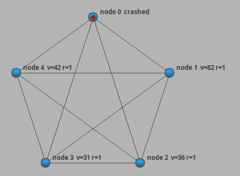

# Distributed Consensus Simulator

A simulation of fault-tolerant consensus in an asynchronous network, written in Java on top of the [JBotSim](https://jbotsim.io) simulator.

A group of nodes must agree on a single value even though some of them can crash at any time. Each node runs a heartbeat failure detector and the Chandra-Toueg rotating coordinator algorithm.



*Node 0 is down from the start and node 1 crashes a few ticks later (red). The remaining nodes detect the failures, move on to the next coordinator and all decide the same value (green).*

## Running it

Requires Java 17 or later. JBotSim (LGPL v3) is included in `lib/`.

```bash
./run.sh            # interactive simulation with 5 nodes
./run.sh 7          # with 7 nodes
./run.sh check      # headless test campaign (see below)
```

In the window, **left-click a node to crash it**. Each node shows its current value and round (`v=42 r=3`) and turns green once it has decided. Events are logged to the console.

## How it works

**Network model.** The nodes form a complete graph. Channels are reliable and FIFO, with random delays (exponential, 5 ticks on average). Nodes fail by crashing and never recover. Consensus is possible as long as a majority of nodes stay alive.

**Failure detector** ([`HeartbeatNode`](src/consensus/HeartbeatNode.java)). Every node sends a heartbeat every 10 ticks and suspects any node it has not heard from within a timeout. In an asynchronous network a slow node can be suspected by mistake. When that happens, the suspicion is lifted and the timeout for that node is increased, so mistakes get rarer over time and in the end only crashed nodes stay suspected.

**Consensus** ([`ConsensusNode`](src/consensus/ConsensusNode.java)). Rounds are led by a coordinator that changes every round (node `(r - 1) mod n`):

1. Every node sends its current estimate, tagged with the round in which it adopted it, to the coordinator.
2. Once the coordinator has a majority of estimates, it proposes the most recent one.
3. Each node either receives the proposal, adopts it and replies ACK, or suspects the coordinator and replies NACK. Either way it moves to the next round.
4. If the coordinator collects a majority of ACKs, it decides and broadcasts the decision. Every node relays the decision once, so it reaches everyone even if the coordinator crashes mid-broadcast.

Two majorities always overlap, so once a value has been acknowledged by a majority, every later coordinator sees it as the most recent estimate and can only propose that value again. This is what guarantees agreement.

## Testing

`./run.sh check` runs 1,000 headless simulations for each scenario below and checks the three consensus properties on every run:

- **agreement:** no two nodes decide different values;
- **validity:** the decided value is one of the initial values;
- **termination:** every node that did not crash eventually decides.

| Scenario | What happens | Avg. ticks to decide |
|---|---|---|
| random | up to *f* random nodes crash at random times | 20 |
| coordinators | the first *f* coordinators are dead from the start | 64 |
| silent-decide | *f* nodes crash right after deciding, before telling anyone | 26 |
| slow-network | average delay equals the detector timeout, so there are many false suspicions | 332 |

*f* = (n - 1) / 2, with networks of 3 to 9 nodes. All 4,000 runs pass, in about 4 seconds.

To make sure these tests actually detect bugs, I ran them against deliberately broken versions of the algorithm: ignoring timestamps when choosing the proposal, deciding after a single ACK, and proposing without a majority of estimates. Each of them produces agreement violations.

## Project structure

```
src/consensus/
├── Main.java              interactive simulation
├── Simulation.java        network setup (complete graph, async FIFO channels)
├── HeartbeatNode.java     failure detector with adaptive timeouts
├── ConsensusNode.java     rotating coordinator consensus
├── ConsensusMessage.java  message types
├── LabelPainter.java      draws node state in the viewer
└── BatchCheck.java        headless test campaign
```

## Context

This started as a lab assignment for a Master's course on distributed algorithms and was later completed and tested.

Reference: T. D. Chandra and S. Toueg, *Unreliable Failure Detectors for Reliable Distributed Systems*, Journal of the ACM, 1996.
